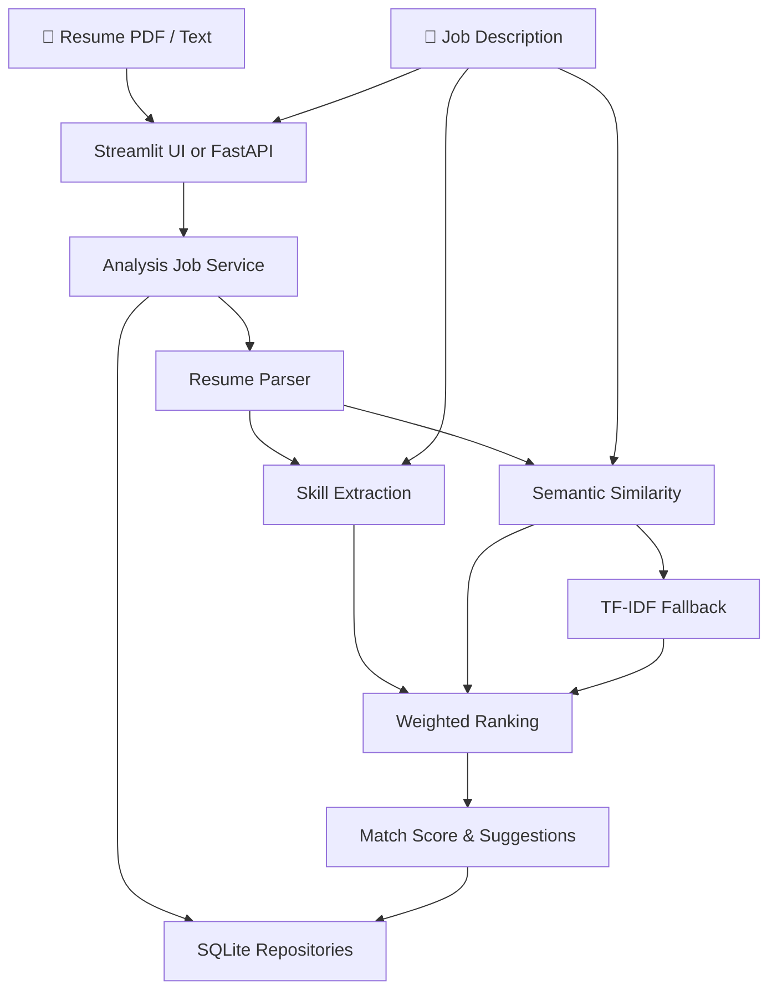

# AI Resume Analyzer & Job Matcher

<p align="center">
  <strong>Turn resumes into insights. Connect skills with opportunities.</strong>
  <br>
  An NLP-powered resume analysis and job matching service built with Python, Streamlit, FastAPI, and SentenceTransformers.
</p>

<p align="center">
  
  
  
  
  
</p>

---

## ✨ Overview

**AI Resume Analyzer & Job Matcher** is a resume analysis service designed to compare a candidate's resume against a job description using Natural Language Processing (NLP), semantic similarity, skill extraction, and weighted ranking.

The system goes beyond simple keyword matching by combining semantic similarity with skill overlap to generate a match score and actionable improvement suggestions.

The project preserves its original Streamlit experience while introducing a modular service architecture and a FastAPI backend, creating a foundation for future SaaS-style development.

## 🚀 Key Features

- 📄 **Resume Parsing** — Upload a PDF or provide resume text for analysis.
- 🧠 **Semantic Similarity** — Use SentenceTransformers to compare resume content with job requirements.
- 🛠️ **Skill Extraction** — Identify relevant skills using an existing skills catalog.
- 🎯 **Weighted Match Scoring** — Combine semantic similarity and skill overlap into a single score.
- 💡 **Improvement Suggestions** — Highlight opportunities to improve resume alignment with a job description.
- ⚡ **Asynchronous Analysis Jobs** — Submit analysis requests and track their progress through FastAPI.
- 🔄 **TF-IDF Fallback** — Provide an alternative similarity approach when using the semantic embedding provider is not possible.
- 💾 **SQLite Persistence** — Store analysis jobs and results through repository abstractions.
- ⚡ **Similarity Caching** — Reduce repeated computation using an in-memory TTL cache.
- 🐳 **Docker Support** — Run the API and Streamlit interface as containerized services.
- 🧪 **Automated Testing** — Test application behavior using deterministic fakes for expensive model dependencies.
- 🔧 **Developer Tooling** — Environment-based configuration, structured logging, Ruff, Black, and GitHub Actions CI.

## 🏗️ System Architecture

The application separates user interface concerns, API endpoints, business workflows, NLP processing, and persistence into dedicated components.



### Core Components

| Component | Responsibility |
|---|---|
| **Streamlit** | Interactive resume analysis interface |
| **FastAPI** | HTTP API, request validation, and analysis endpoints |
| **Services** | Business workflows and background job orchestration |
| **Parsers** | PDF and text extraction |
| **Embeddings** | Semantic similarity providers and cache integration |
| **Ranking** | Weighted match scoring and report generation |
| **Repositories** | Persistence boundaries for jobs and results |
| **SQLite** | Local persistence |
| **Pytest** | Automated tests using deterministic fakes |

## 🧮 Matching Algorithm

The system combines two complementary signals:

1. **Semantic Similarity (60%)** — Estimates how closely the resume's meaning aligns with the job description.
2. **Skill Overlap (40%)** — Measures overlap between the candidate's extracted skills and the job's requirements.

The default scoring formula is:

\[
\text{Match Score} = 0.6S + 0.4K
\]

Where:

- \(S\) = semantic similarity score
- \(K\) = skill overlap ratio

The default weights are configurable through environment variables, allowing the balance between semantic relevance and explicit skill matching to be adjusted.

> **Note:** The match score is a ranking signal, not a guarantee of hiring success or a complete assessment of candidate suitability.

## 🧰 Tech Stack

| Technology | Role |
|---|---|
| **Python** | Application logic and service implementation |
| **Streamlit** | User-facing interface |
| **FastAPI** | Backend API |
| **SentenceTransformers** | Semantic embeddings and similarity |
| **scikit-learn** | TF-IDF fallback and related ML utilities |
| **SQLite** | Persistent storage |
| **Pytest** | Automated testing |
| **Ruff & Black** | Linting and code formatting |
| **Docker Compose** | Local multi-service deployment |
| **GitHub Actions** | Continuous integration |

## 📂 Project Structure

```text
resume_analyzer/
├── api/             # FastAPI routes and request/response schemas
├── cache/           # Cache interfaces and in-memory TTL adapter
├── database/        # SQLite connection and schema bootstrap
├── embeddings/      # Similarity providers and cache wrapper
├── parsers/         # PDF and text document parsing
├── ranking/         # Match scoring and report generation
├── repositories/    # Persistence boundaries for jobs/results
├── services/        # Business workflows and job orchestration
└── utils/           # Logging and typed application errors

app.py               # Streamlit interface
requirements.txt     # Python dependencies
.env.example         # Example environment configuration
docker-compose.yml   # Multi-service Docker configuration
```

## ⚙️ Getting Started

### Prerequisites

- Python 3.11 or compatible environment
- pip
- Git
- Docker Desktop (optional, for containerized execution)

### 1. Clone the Repository

```bash
git clone <your-repository-url>
cd <your-repository-directory>
```

Replace the placeholders with your repository's actual URL and directory name.

### 2. Create a Virtual Environment

```bash
python -m venv venv
```

Activate it on Windows:

```powershell
venv\Scripts\activate
```

On macOS or Linux:

```bash
source venv/bin/activate
```

### 3. Install Dependencies

```bash
pip install -r requirements.txt
```

For a lighter CPU-only PyTorch installation, use the following approach if appropriate for your environment:

```bash
pip install torch --index-url https://download.pytorch.org/whl/cpu
pip install -r requirements.txt
```

### 4. Configure Environment Variables

Copy `.env.example` to `.env` and adjust the settings as needed.

The application supports configuration for its runtime environment, logging, database location, embedding model, cache, scoring weights, upload size, and job-processing behavior.

Keep `.env` out of version control.

## 🖥️ Run the Application

### Streamlit Interface

```bash
streamlit run app.py
```

Open:

**http://localhost:8501**

### FastAPI Backend

```bash
uvicorn resume_analyzer.api.main:app --reload
```

Open the interactive API documentation:

**http://127.0.0.1:8000/docs**

Versioned endpoints are available under `/api/v1`, while unversioned routes remain available for compatibility.

## 🔌 API Overview

| Method | Endpoint | Purpose |
|---|---|---|
| `GET` | `/health` | Check service health |
| `POST` | `/analyses/text` | Submit resume text for analysis |
| `POST` | `/analyses/file` | Submit a resume file for analysis |
| `GET` | `/analyses` | List analysis jobs with optional filters and pagination |
| `GET` | `/analyses/{analysis_id}/status` | Retrieve job status |
| `GET` | `/analyses/{analysis_id}` | Retrieve analysis details |

### Example Analysis Response

Submission endpoints return a queued job identifier:

```json
{
  "analysis_id": "uuid",
  "status": "queued"
}
```

The client can then check the job status and retrieve the result when processing is complete.

## 🐳 Docker Deployment

Build the shared image:

```bash
docker compose build
```

Start the API and Streamlit services:

```bash
docker compose up
```

Run in the background:

```bash
docker compose up -d
```

Inspect running services:

```bash
docker compose ps
```

Follow service logs:

```bash
docker compose logs -f api
docker compose logs -f streamlit
```

Stop the services:

```bash
docker compose down
```

Default local endpoints:

- Streamlit: `http://localhost:8501`
- FastAPI: `http://localhost:8000`

SQLite persistence is mounted under `./data`, which is ignored by Git.

## 🧪 Testing & Code Quality

Run the test suite:

```bash
pytest
```

Check formatting and linting:

```bash
ruff check .
black --check .
```

Compile Python modules:

```bash
python -m compileall .
```

GitHub Actions runs these checks on pushes and pull requests using Python 3.11.

The tests use deterministic fakes for model-heavy behavior and an inline background runner for reproducible job processing.

## 🔧 Configuration Reference

| Variable | Default | Purpose |
|---|---|---|
| `RESUME_ANALYZER_APP_NAME` | `AI Resume Analyzer` | Application display name |
| `RESUME_ANALYZER_ENVIRONMENT` | `local` | Runtime environment |
| `RESUME_ANALYZER_LOG_LEVEL` | `INFO` | Logging level |
| `RESUME_ANALYZER_DATABASE_PATH` | `resume_analyzer.db` | SQLite database path |
| `RESUME_ANALYZER_EMBEDDING_MODEL_NAME` | `all-MiniLM-L6-v2` | SentenceTransformer model |
| `RESUME_ANALYZER_CACHE_ENABLED` | `true` | Enable similarity caching |
| `RESUME_ANALYZER_CACHE_TTL_SECONDS` | `3600` | Cache time-to-live |
| `RESUME_ANALYZER_SEMANTIC_WEIGHT` | `0.6` | Semantic similarity weight |
| `RESUME_ANALYZER_SKILL_WEIGHT` | `0.4` | Skill overlap weight |
| `RESUME_ANALYZER_MAX_UPLOAD_SIZE_MB` | `10` | Configured upload size limit |
| `RESUME_ANALYZER_JOB_MAX_RETRIES` | `2` | Retry count for unexpected job failures |
| `RESUME_ANALYZER_JOB_TIMEOUT_SECONDS` | `120` | Job timeout budget |
| `RESUME_ANALYZER_STALE_JOB_AGE_SECONDS` | `3600` | Stale-job age threshold |

## 💼 Example Use Case

Consider a job description for a Senior Python Developer / Machine Learning Engineer that requires:

- Python development experience
- Django or FastAPI
- PyTorch, TensorFlow, or scikit-learn
- NLP or computer vision experience
- PostgreSQL and Redis
- Docker, Kubernetes, and CI/CD
- AWS or GCP

The analyzer compares a candidate's resume against these requirements to estimate semantic relevance, evaluate skill overlap, calculate a weighted match score, and suggest areas where the resume could better reflect the role's requirements.

## 🔒 Design Considerations

- **Modular architecture:** Keep parsing, ranking, persistence, and API concerns separated.
- **Configurable behavior:** Adjust model selection, caching, and scoring weights through environment variables.
- **Resilient similarity:** Retain a TF-IDF fallback for similarity operations.
- **Reproducible tests:** Use deterministic fakes for expensive model dependencies.
- **Responsible interpretation:** Treat match scores as decision-support signals rather than definitive judgments about a candidate.

## 🛣️ Future Direction

The architecture provides a foundation for further development, such as richer reporting, additional matching strategies, improved job-processing infrastructure, and future SaaS capabilities.

These are potential extensions rather than claims about currently implemented features.

---

<p align="center">
  <strong>From resumes to relevance. From skills to opportunities.</strong>
  <br><br>
  Built with Python, NLP, and Machine Learning.
</p>
